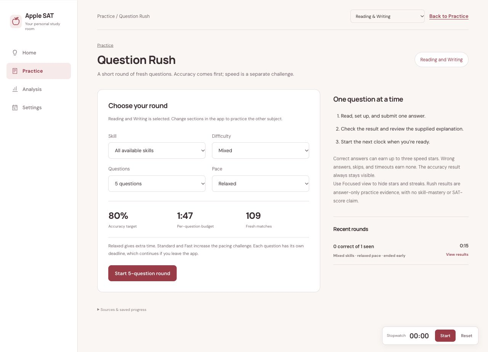

<p align="center"></p>

<h1 align="center">Apple SAT</h1>

<p align="center"><strong>Know what to study next.</strong><br>A free desktop study room for Digital SAT Math and Reading and Writing.<br>Turn your official results into a daily path of lessons, practice, and review.</p>

<p align="center"><a href="https://bobananaa.github.io/apple-study-sat/#download"><strong>Download for Mac or Windows →</strong></a><br><a href="docs/GETTING_STARTED.md">Getting started</a> · <a href="https://github.com/boBananaa/apple-study-sat/releases/latest">Release notes</a> · <a href="CONTRIBUTING.md">Contribute</a></p>

<p align="center"><a href="https://github.com/boBananaa/apple-study-sat/releases/latest"></a> <a href="https://github.com/boBananaa/apple-study-sat/actions/workflows/desktop.yml"></a></p>


*Actual app, example profile. Screenshots do not show a real student's results.*

**No account, subscription, or AI API key.** Lessons and Desmos exercises are included. Official question-bank material is **not bundled**; question practice and Question Rush use a compatible library you import yourself. Preparing that library currently requires Python and the repository's PDF importer.

## Download and start

1. **[Download the desktop app](https://bobananaa.github.io/apple-study-sat/#download).** Choose the universal `.dmg` for an Apple Silicon or Intel Mac, or the x64 `setup.exe` for Windows 10/11. The GitHub **Code → Download ZIP** button downloads source code, not an installer.
2. **Get one useful result.** Open **Practice → Lessons and study tools → Lessons**, choose Math or Reading and Writing, and complete one original lesson check. You can do this before importing any questions.
3. **Build your roadmap.** In **Home**, enter the two section scores and eight domain bands from one official SAT or full-length Bluebook report. Add your target, next test date, and routine. Your next study step appears on Home. Haven't taken an official test? Home links to Bluebook; lessons remain available meanwhile.

**Early preview:** installers are not Apple-notarized or Windows publisher-signed. Update packages use a separate verification signature. Mac updating has been exercised from 0.2.3 to 0.2.4; Windows builds and native tests pass in CI, but Windows interface and installation testing remain unverified.

[First-use guide and troubleshooting](docs/GETTING_STARTED.md) · [Prepare your question library](docs/DEVELOPMENT.md#load-your-own-pdf-question-bank)

## A plan grounded in your results

One place to decide what comes next, with four main tabs: **Home · Practice · Analysis · Settings**.

| Study tool | What it helps you do |
| --- | --- |
| **Your daily path** | Prioritize weaker areas from your official report, then refine the next skill and difficulty using fresh practice. Periodic Bluebook checkpoints refresh the plan. |
| **111 original lessons** | Cover all 29 question-bank skills: 73 Math lessons and 38 Reading and Writing lessons, with worked examples, traps, and recognition rules. |
| **Setup-first practice** | Write an equation or reasoning before answering. Keep first answers, hints, corrections, confidence, and delayed fresh checks distinct. |
| **32 Desmos methods** | Learn when a calculator shortcut applies, then try an original application question for each method. |
| **Question Rush** | Train pacing with 5-, 10-, or 20-question rounds, pace choices, and optional stars and streaks. Timed rounds unlock after two stable practice sets; speed results stay separate from setup mastery. |
| **Review and study tools** | Rework misses, check retention later with fresh questions, use the stopwatch and scratchpad, or review vocabulary. |

### See the study room

<details>
<summary><strong>Lessons — learn a method before the next question</strong></summary>


Lesson checks are tutorial practice; completing one does not establish mastery.

</details>

<details>
<summary><strong>Desmos — learn a shortcut, then apply it</strong></summary>


Original exercises are labeled separately from official PDF questions.

</details>

<details>
<summary><strong>Question Rush — choose a focus and a pace</strong></summary>



This capture uses a locally imported sample library and disposable test records. Question libraries are not included in the download.

</details>

## Your progress stays on your computer

- **Study offline after installation.** Updates and external resources such as Bluebook, Khan Academy, and Desmos need an internet connection.
- **Back up what matters.** Export from **Settings → Question library and backups**. Import that backup to move progress to another installation; there is no automatic cloud sync.
- **Bring your own questions.** The [PDF importer](docs/DEVELOPMENT.md#load-your-own-pdf-question-bank) prepares supported question-bank PDFs. Import its output folder through the desktop Settings. Earlier attempted IDs remain excluded from fresh practice.
- **Keep expectations realistic.** Domain bands cover several skills, not exact-skill accuracy. App simulations and Rush results are not calibrated SAT scores. Practice and test-day scores can differ in either direction; no score increase is guaranteed.

Installed apps check for updates on launch and every six hours. A successful push to `main` builds both platforms; only a completed release is published. The app verifies its update signature and installs outside an exercise before restarting. Imported libraries and study data are stored separately from the app bundle. [How releases work](docs/RELEASING.md).

## Help and feedback

Start with [setup and troubleshooting](docs/GETTING_STARTED.md#troubleshooting). If you're still stuck, [open an issue](https://github.com/boBananaa/apple-study-sat/issues/new/choose) with your operating system, app version, expected result, and steps to reproduce it. Don't attach personal score reports, progress backups, credentials, or question PDFs. Use sample data in screenshots.

## Build or contribute

For a local desktop build, install Node.js 22+, Rust, and the [Tauri platform prerequisites](https://v2.tauri.app/start/prerequisites/). From the repository root:

```sh
npm ci
npm test
npm run desktop:dev
```

**Expected result:** a local Apple SAT desktop window with lessons and an empty question library. Packaging installers uses `npm run desktop:build`; signing and cross-platform release setup are separate.

[Contribution guide](CONTRIBUTING.md) · [Developer guide and PDF importer](docs/DEVELOPMENT.md) · [Release setup](docs/RELEASING.md)

## License and credits

Application code is provided under the [MIT license](LICENSE). That license does not grant rights to imported question PDFs, images, answer keys, or trademarks. Bundled fonts retain their [own license notices](dist/fonts/).

Apple SAT is an independent project, not affiliated with or endorsed by College Board, Khan Academy, Desmos, or Apple. Lessons are originally authored; their scope references [College Board's assessment framework](https://satsuite.collegeboard.org/media/pdf/assessment-framework-for-digital-sat-suite.pdf) and its [Khan Academy course guidance](https://satsuite.collegeboard.org/practice/khan-academy). GitHub Pages is this project's download page; the study app runs on your computer.
