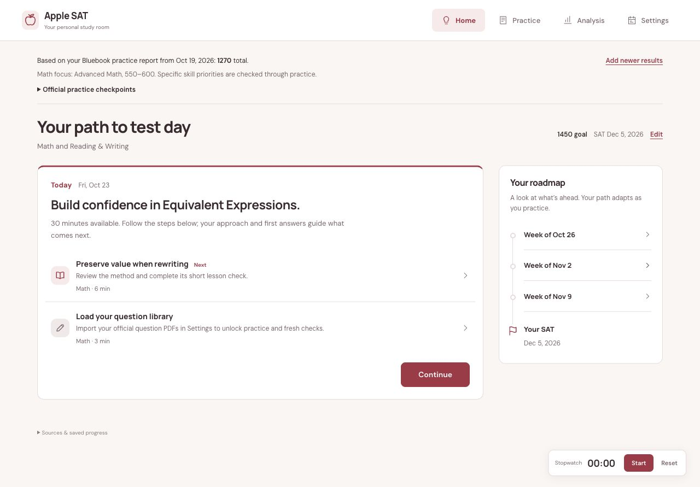
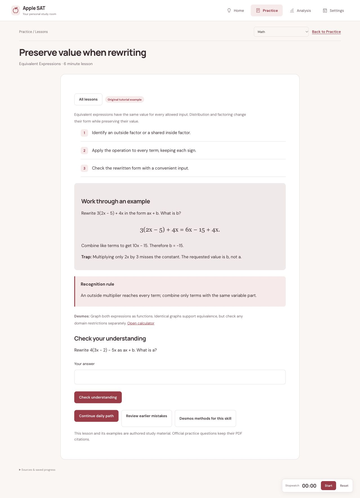
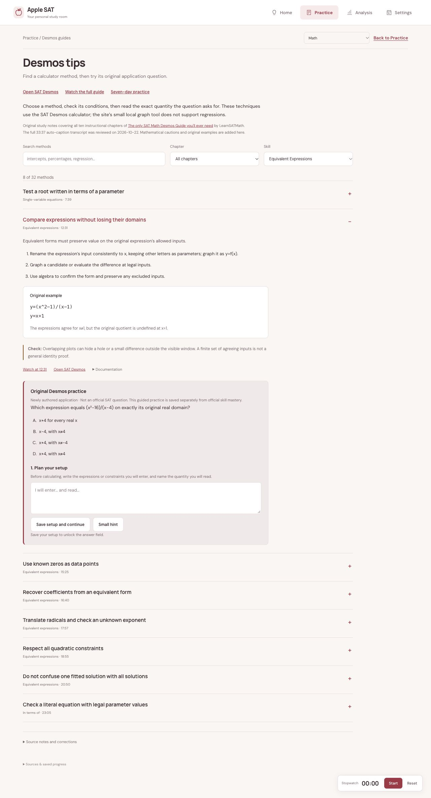

# Apple SAT

**Know what to study next.** A free, open-source desktop app for Mac and Windows that turns your latest official SAT results into a daily study path.

[**Download Apple SAT**](https://bobananaa.github.io/apple-study-sat/#download) · [Latest release](https://github.com/boBananaa/apple-study-sat/releases/latest) · [How it works](https://bobananaa.github.io/apple-study-sat/#study)



*Screenshots use an example profile, not a real student's results.*

## A plan grounded in your results

Enter the section scores and eight domain bands from one actual SAT or official Bluebook practice test. Apple SAT focuses the path on weaker areas, then uses fresh-question results to refine the skill and difficulty. Haven’t taken a test? Start with the official Bluebook test linked in Home.

- **A manageable day:** one Continue button, a short lesson/practice/review sequence, and saved-session resume.
- **Both SAT sections:** 111 original lessons covering all 29 question-bank skills, with worked examples, traps, recognition rules, and checks.
- **Learn Desmos by applying it:** 32 methods, each with its own original practice question and a setup before the answer.
- **Check progress over time:** periodic official Bluebook checkpoints refresh the roadmap until your test date or until you pause them because you’re happy with your practice score.
- **Question Rush:** short timed rounds in both sections, with pace choices, accuracy, streaks, and speed stars. Misses go to Review; speed scores do not establish setup mastery.
- **Practice honestly:** first answers, hints, corrections, confidence, and delayed fresh checks stay distinct. No invented mastery or predicted SAT scores.
- **Keep your study room local:** stopwatch, scratchpad, question annotations, vocabulary, and backups. No account, server, subscription, or AI API key required.

<details>
<summary>See lessons and Desmos practice</summary>





</details>

## Download and start

Choose the **Mac universal** installer for Apple Silicon or Intel, or the **Windows** installer. These early builds are not Apple-notarized or Windows publisher-signed; they are labeled as preview releases. Update packages have their own verification signatures.

1. Install the app and enter your latest official test report in Home.
2. Set your target, next SAT date, available time, and study days.
3. Follow the next step. Enter a new official practice report at each checkpoint.

Lessons and Desmos exercises are included. **Official question-bank PDFs are not bundled.** To practice your own questions, use the [PDF importer](docs/DEVELOPMENT.md#load-your-own-pdf-question-bank), then choose **Settings → Desktop app → Import prepared question library**. Bring existing browser progress over with an exported backup. Imported library attempt IDs stay excluded from fresh practice; full results move through progress backups.

## Automatic updates

Successful app-source pushes to `main` build Mac and Windows installers and publish a new GitHub Release. Installed apps check on launch and every six hours, verify the update signature, and install outside an exercise before restarting. Reports, progress, and imported libraries are stored separately from the app bundle. Offline study continues when updates cannot be checked.

GitHub Pages is the download and information page. It does not store study data or run the app's learning engine. A future hosted app can be developed separately.

## Privacy and accuracy

Your scores, notes, and practice history stay on your device unless you export them. They do not sync to this repository. Keep private backups and question material out of public forks. Only redistribute materials you have permission to share.

Official reports provide broad domain bands, not exact-skill accuracy. Practice scores can differ from test-day scores in either direction. Apple SAT is independent of College Board, Khan Academy, Apple, and Dolphin. Lessons are originally authored, with scope checked against [College Board's framework](https://satsuite.collegeboard.org/media/pdf/assessment-framework-for-digital-sat-suite.pdf) and its [Khan Academy course guidance](https://satsuite.collegeboard.org/practice/khan-academy). The app does not guarantee a score increase.

## Build or contribute

Node.js 22+ and the [Tauri prerequisites](https://v2.tauri.app/start/prerequisites/) are needed for desktop development.

```sh
npm ci
npm test
npm run desktop:dev
npm run desktop:build
```

[Developer guide and PDF import](docs/DEVELOPMENT.md) · [Release and update setup](docs/RELEASING.md) · [MIT license](LICENSE)
